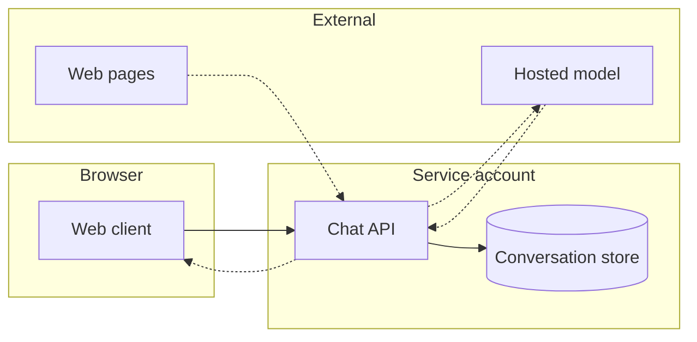

# Example service threat model

Replace every example row. Keep the headings and the table columns. Scores are after the listed controls.

## Scope

The example service's first release: the web client, the chat API, the model call, and web retrieval. Billing and administration are out of scope.

## Assets

- Conversation bodies and prompts
- Access tokens
- Model spend

## Data flow and trust boundaries

## STRIDE

| ID | Component or boundary | Category | Threat | L | I | Risk | Control | Owner | Test |
| --- | --- | --- | --- | --- | --- | --- | --- | --- | --- |
| S-1 | Client to API | Spoofing | A forged token is accepted | 1 | 5 | 5 Low | Issuer, audience, signature, and expiry checked on every request | API team | `test_rejects_forged_token` |
| I-1 | Conversation store | Information disclosure | A query returns another tenant's conversation | 2 | 5 | 10 Medium | Tenant taken from the token and filtered in every query | API team | `test_tenant_filter` |

## STRIDE-AI

| ID | Component | Layer | Category or added row | Threat | L | I | Risk | Control | OWASP LLM | Test |
| --- | --- | --- | --- | --- | --- | --- | --- | --- | --- | --- |
| AI-1 | Chat API | Application | Indirect prompt injection | A retrieved page instructs the model to emit markup | 4 | 3 | 12 High | Retrieved text delimited and labelled as data; output validated against a schema | LLM01 | `test_injected_page_is_data` |
| AI-2 | Web client | User interface | Improper output handling | Model markup is rendered as HTML | 2 | 4 | 8 Medium | Model output rendered as text | LLM05 | `renders_reply_as_text.spec.ts` |
| AI-3 | Chat API | Infrastructure | Resource Exhaustion | Long prompts run up model spend | 3 | 3 | 9 Medium | Input size limit, output token limit, daily spend cap per person | LLM10 | `test_spend_cap` |

## Attack chains

| Chain | Steps (threat IDs) | End state | L | I | Risk | Breaking controls and their layers | Detection | Scenario test |
| --- | --- | --- | --- | --- | --- | --- | --- | --- |
| C-1 | AI-1, AI-2 | A script in a reply reads the access token | 2 | 5 | 10 Medium | Strict content security policy (Edge); output rendered as text (Application); token kept out of script-readable storage (Identity) | CSP violation reports | `chain_injection_to_token.spec.ts` |

## Residual risk

| ID | Risk | Register entry |
| --- | --- | --- |
| AI-1 | 12 High | R-001 |

## Review

- 2026-01-01: first model, reviewed by two people, pull request #1.
